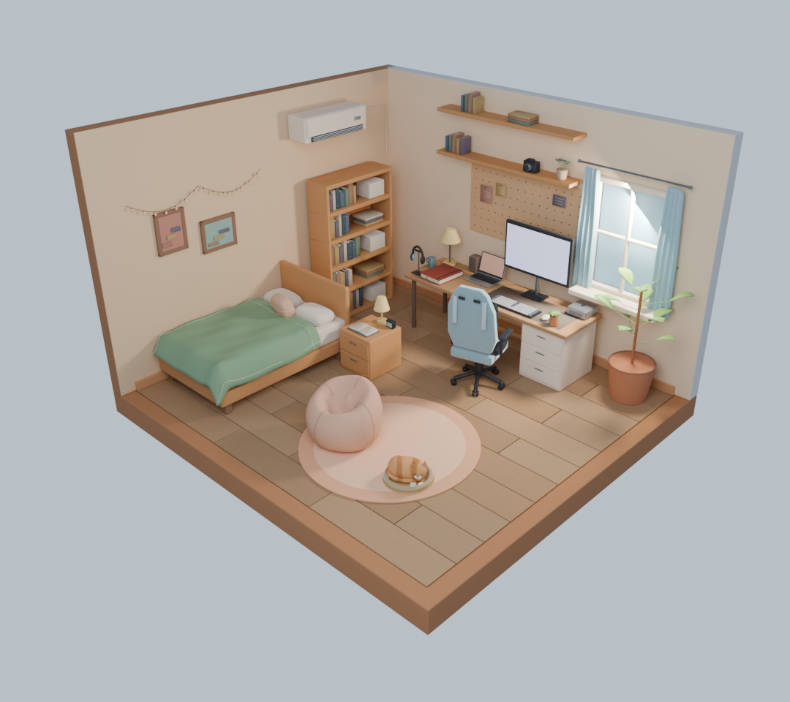

# Cian Lien’s World

*A world of things I build, write, and explore.*

一个可以走进来探索的 3D 个人网站，收藏我的作品、介绍、技术文章与生活记录。

这个世界从一间房间开始。打开电脑，可以了解我和我做过的项目。翻开桌上的日记本，可以阅读我的文章。也可以开关台灯、切换日夜，或摸摸趴在地毯上的猫。

白天使用城市鸟鸣作为背景声，夜晚使用夜间城市实录。两段录音随房间的昼夜切换。



*房间场景的 Blender 渲染参考图。*

## 当前体验

| 入口或操作 | 可以做什么 |
| --- | --- |
| 日记本 | 浏览文章目录，阅读 Markdown 文章，通过链接分享某一篇文章 |
| 电脑 | 进入 RoomOS 桌面，查看个人介绍、技能、项目与常用链接 |
| 桌面窗口 | 打开、拖动、置顶和关闭应用窗口，通过任务栏切换窗口 |
| 终端 | 使用 `help`、`whoami`、`ls`、`cat <编号>`、`projects` 等内置命令探索内容 |
| 当地时间 | 显示访客所在地区的时间和昼夜，太阳按当地时间移动 |
| 窗户 | 靠近窗户看天光。太阳朝向窗户时，直射光会穿过窗格 |
| 扬声器按钮 | 开启声音或一键静音 |
| 台灯 | 独立开关灯光，播放开关音效 |
| 猫 | 触发跳跃、叫声和对话气泡 |
| 鼠标拖动 / 滚轮 | 在房间总览中旋转视角、缩放画面 |
| `Esc` / 返回房间 | 从电脑或日记本回到房间总览 |

点击日记本和电脑时，镜头会平滑移动到对应位置。打开日记本、翻页和点击电脑也有对应音效。

手机上可点按物件探索房间。个人资料、项目和外部链接目前包含示例内容，可在配置文件中更新。

## 技术栈

| 部分 | 技术 |
| --- | --- |
| 界面与开发语言 | React 18、TypeScript |
| 3D 场景 | Three.js、React Three Fiber、drei |
| 模型与光照制作 | Blender、glTF / GLB、分层光照烘焙 |
| 实时渲染 | 烘焙光照与实时光照混合、N8AO 环境光遮蔽 |
| 文章内容 | Markdown、简单 frontmatter、marked |
| 路由 | 基于 URL hash 的视图切换 |
| 开发与构建 | Vite 8、pnpm |
| 多语言 | i18next、react-i18next，简体中文与英文 |

文章与个人信息随前端构建，模型、贴图和音效作为静态资源加载。

## 本地运行

准备 Node.js 和 pnpm，在项目根目录执行以下命令。开发和测试支持 Node.js 22.12+（22.x）、24.x 或 26+，建议使用 Node.js 24 LTS；pnpm 通过 `packageManager` 固定为 12.8.1。本地验证环境为 Node.js 24.22.1、pnpm 12.8.1。

```bash
pnpm install --frozen-lockfile
pnpm dev
```

打开终端输出的本地地址，默认端口为 `5173`。

| 命令 | 用途 |
| --- | --- |
| `pnpm dev` | 启动开发服务器 |
| `pnpm typecheck` | 执行 TypeScript 类型检查 |
| `pnpm test` | 验证语言选择、词典及资料一致性 |
| `pnpm build` | 构建静态站点，输出到 `dist/` |
| `pnpm preview` | 在本地预览构建产物 |

日常前端开发直接使用仓库中的模型和贴图。修改模型或重新烘焙光照时需要 Blender。

## 维护个人内容

### 个人介绍与作品

编辑 [`src/content/site.ts`](src/content/site.ts)，更新以下内容。

- `title` 用于网站名称和各视图的页面标题。
- `name`、`avatar`、`role`、`bio`、`location` 和 `skills` 用于个人介绍。
- `projects` 用于作品列表，每个项目包含名称、描述、技术标签和链接。
- `links` 用于桌面浏览器中的常用链接。

RoomOS 中的个人介绍、项目窗口和终端会读取这份配置。页面标题及左上角的网站名称由 `site.title` 提供，个人姓名由 `site.name` 提供。

### 发布文章

在 `content/posts/` 中新建 Markdown 文件，例如 `my-first-post.md`。

```markdown
---
title: 从一个房间开始
date: 2026-11-07
tags: [开发记录, Three.js]
summary: 记录这个个人世界的第一步。
draft: false
---

这里是文章正文，可以记录技术实践、作品背后的故事或生活片段。
```

文件名会成为文章的 slug，上面的文件对应 `#/diary/my-first-post`。

- `date` 使用 `YYYY-MM-DD` 格式，文章按日期从新到旧排列。
- 设置 `draft: true` 可以将文章排除在发布列表之外。
- frontmatter 支持简单的 `key: value` 和单行数组 `key: [a, b]`。
- 图片可放在 `public/images/`，站点部署在域名根目录时可使用 `/images/文件名` 引用。

新增或修改文章后，重新构建即可更新部署内容。

### 多语言

房间、RoomOS、日记本界面、个人资料和项目介绍支持简体中文与英文，可通过顶部或日记本内的语言选择器切换。文章继续显示原文，英文阅读界面会提示文章当前为中文。

- 语言优先读取 URL，再读取保存的手动选择、浏览器语言，最后回退到简体中文。
- 分享英文界面可使用 `?lang=en#/computer` 或 `?lang=en#/diary/hello-room`；旧 Hash 链接和烘焙参数继续有效。
- 界面词典位于 `src/i18n/resources.ts`；双语个人资料、项目和书签在 `src/content/site.ts` 按稳定 ID 维护，共用链接和技术名称。
- 切换语言保留房间与窗口状态，终端历史保留执行时的内容。文章内容与 `Post` / `posts` 接口保持不变。

完整选型、接口和维护规则见 [多语言实现文档](docs/i18n.md)。

## 页面地址

| 地址 | 视图 |
| --- | --- |
| `#/` | 房间总览 |
| `#/computer` | 电脑桌面 |
| `#/window` | 室内窗边视角 |
| `#/diary` | 日记本目录 |
| `#/diary/<slug>` | 指定文章 |

地址随视图同步更新，支持浏览器前进、后退和直接访问文章链接。

## 项目结构

```text
content/posts/                 Markdown 文章
src/
  App.tsx                     顶层界面、日夜状态与返回操作
  route.ts                    Hash 路由与文章链接
  sound.ts                    交互音效
  content/
    site.ts                   个人介绍、作品和外部链接
    posts.ts                  构建时读取文章
    parsePosts.ts             Frontmatter 解析与 Markdown 转换
  scene/
    Experience.tsx            Canvas 与场景入口
    Room.tsx                  GLB 模型加载与物体交互
    CameraRig.tsx             镜头移动、旋转和缩放限制
    ComputerScreen.tsx        将 RoomOS 映射到 3D 电脑屏幕
    Interactive.tsx           可交互物体与悬停提示
    HybridTrialLayers.tsx     混合光照与后处理
    bakeTrial.ts              渲染模式与资源路径选择
    layout.ts                 镜头、屏幕和布局参数
  ui/
    Desktop.tsx               RoomOS 桌面、窗口和内置应用
    DiaryOverlay.tsx          日记本阅读界面
public/
  bake-room/                  默认场景使用的模型与光照资源
  bake-hybrid/                混合光照试验资源
  bake-trial/                 分层烘焙试验资源
  models/                     模型导出文件
  sounds/                     交互音效
assets/blender/
  room.blend                  Blender 场景源文件
  reference/                  渲染参考与对比图
  scripts/                    建模、验证、烘焙与优化脚本
```

## 场景与资源维护

默认场景加载 `public/bake-room/room.glb`，以日间环境光、夜景和台灯贴图为底光，叠加透过真实窗洞的太阳直射和窗格阴影。生产烘焙会同时输出原始日景和去掉固定窗光的日间环境贴图，供对照和实时房间分别使用。

模型中的 `Diary`、`Computer`、`Lamp` 和 `Cat` 节点用于绑定交互。调整模型时应保留这些节点，并同步检查 `src/scene/layout.ts` 中的镜头与电脑屏幕坐标。

开发时可以通过查询参数查看不同的渲染路径。

| 查询参数 | 渲染路径 |
| --- | --- |
| 默认，无参数 | `public/bake-room/` 中的混合光照资源 |
| `?bake=hybrid` | `public/bake-hybrid/` 中的混合光照试验资源 |
| `?bake=trial` | `public/bake-trial/` 中的分层烘焙试验资源 |
| `?bake=live` | `public/models/room-day-warm.glb` 与实时光照 |

例如，在开发服务器地址后添加 `?bake=live#/` 可以查看实时光照版本。

重新生成混合光照资源时，可使用仓库中的脚本。

```bash
# 生成试验资源，输出至 public/bake-hybrid/
bash assets/blender/scripts/v3/run_hybrid_trial.sh

# 生成默认场景资源，输出至 public/bake-room/
bash assets/blender/scripts/v3/run_hybrid_trial.sh --production
```

脚本读取 `assets/blender/room.blend` 和 `public/models/room-day-warm.glb`，并在临时目录中安装优化工具。默认使用 macOS 的 Blender 路径与 Metal 烘焙设备，可通过 `ROOM_BLENDER_BIN` 指定 Blender 可执行文件。完整烘焙需要较长时间，适合在更新场景资源时执行。

## 构建与部署

```bash
pnpm typecheck
pnpm build
pnpm preview
```

部署需要静态资源与 `worker/index.ts` 的同源天气端点。纯静态托管仍能展示场景，但实时天气将使用晴天兜底。构建时需要同时保留 `public/` 中的模型、贴图、manifest 和音效，这些资源会由 Vite 复制到构建目录。

部署到子路径时，在 `vite.config.ts` 中配置对应的 `base`，并检查文章中的图片路径是否与部署路径一致。Hash 路由中的电脑和文章地址共用同一个页面入口。

### Cloudflare Workers

仓库中的 `wrangler.jsonc` 将 `dist/` 作为静态资源发布到 Worker `cian-world`。项目使用 Hash 路由；Worker 仅优先处理 `/api/*`，其余请求直接托管静态资源。

在 Workers Builds 中连接仓库，生产分支选择 `main`，根目录使用仓库根目录，构建命令设置为 `pnpm run build`，部署命令设置为 `npx wrangler deploy`。pnpm 版本由 `packageManager` 固定，Node.js 建议使用 24 LTS。

本地部署前先执行 `pnpm build`，再执行 `npx wrangler deploy`（需要 Cloudflare 登录权限）。可用 `npx wrangler deploy --dry-run` 检查部署配置而不发布。

保留明确的 Wrangler 配置，使 CI 直接上传构建产物，避免部署阶段自动改写 Vite 配置并临时安装依赖。静态资源配置见 [Cloudflare 官方文档](https://developers.cloudflare.com/workers/static-assets/binding/)。

## 后续方向

- [ ] 完善移动端触控、布局与渲染性能适配。
- [ ] 改进文章的搜索引擎可访问性与直接阅读体验。

## 昼夜与声音

房间按 Cloudflare 提供的城市级近似位置和当地时间计算太阳位置。地区不可用时，使用设备时钟和广州太阳轨迹作估算。首次点击或按键后播放对应的背景声，切换时做等功率交叉淡化，静音偏好保存在浏览器。录音来源见[素材与授权记录](assets/CREDITS.md)。

在地址中加入 `?debugSun=1` 可以拖动当地时间、切换到天空视角看日出日落，并恢复实时。调试时间随刷新清除。

天台模型和阶段对照保留在[天台研发记录](docs/reference/README.md)。站点入口显示室内房间。
